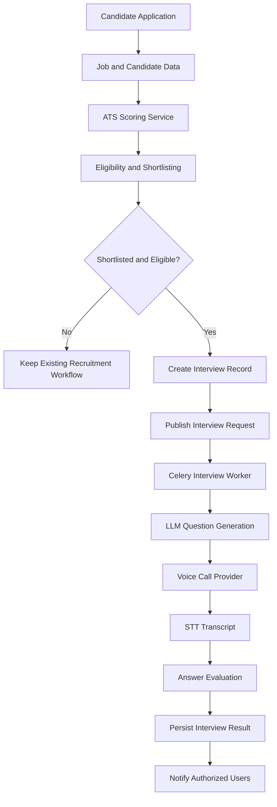

# Day 31: Event and Data Flow Mapping

## 1. Scope

This document maps the existing recruitment events and the additional events proposed for an AI voice-interview workflow.

Existing events are based on the current Zecpath backend context. Proposed interview events describe future integration requirements and must not be treated as implemented until code and tests confirm them.

## 2. Event Mapping

| Event | Producer | Consumer | Data to persist | Status |
|---|---|---|---|---|
| `application_submitted` | Application API/workflow | Notification task | Application ID, candidate ID, job ID, timestamp | Existing notification event |
| `shortlisted` | Shortlisting workflow | Notification task | Application ID, job ID, timestamp | Existing notification event |
| `rejected` | Application/shortlisting workflow | Notification task | Application ID, job ID, timestamp | Existing notification event |
| `interview_requested` | Proposed interview API | Interview worker | Interview ID, application ID, idempotency key | Proposed |
| `interview_questions_requested` | Interview worker | LLM adapter | Interview ID, job requirements reference, question-plan version | Proposed |
| `interview_questions_generated` | LLM adapter/worker | Interview persistence | Interview ID, questions, rubric version, provider metadata | Proposed |
| `interview_scheduled` | Interview workflow/provider | Interview API and notification task | Interview ID, scheduled time, timezone, provider reference | Proposed |
| `call_initiation_requested` | Interview worker | Voice provider adapter | Interview ID, idempotency key | Proposed |
| `call_status_updated` | Verified voice webhook | Interview worker | Interview ID, provider call ID, status, event ID | Proposed |
| `transcription_requested` | Interview worker/provider callback | STT adapter | Interview ID, call ID, recording reference | Proposed |
| `transcription_completed` | STT adapter | Interview worker | Interview ID, transcript reference, status | Proposed |
| `answer_evaluation_requested` | Interview worker | Evaluation adapter | Interview ID, question IDs, rubric version | Proposed |
| `answer_evaluation_completed` | Evaluation adapter | Interview persistence | Interview ID, scores, evidence, model/version metadata | Proposed |
| `interview_completed` | Interview orchestrator | Result API and notification task | Interview ID, completion timestamp, result reference | Proposed |
| `interview_failed` | Interview worker | Monitoring/recovery workflow | Interview ID, safe error code, attempt count | Proposed |
| `interview_reschedule_required` | Interview workflow | Scheduling workflow | Interview ID, reason code, attempt count | Proposed |

## 3. Event Envelope

Use a consistent event format for future asynchronous events. This is an illustrative contract, not an existing Zecpath schema.

```json
{
  "event_id": "unique-event-id",
  "event_type": "interview_requested",
  "occurred_at": "ISO-8601 timestamp",
  "correlation_id": "workflow-correlation-id",
  "aggregate_type": "interview",
  "aggregate_id": "interview-id",
  "schema_version": 1,
  "payload": {
    "application_id": 123
  }
}
```

Requirements:
- `event_id` supports deduplication.
- `correlation_id` links logs and tasks across the workflow.
- `aggregate_id` identifies the interview or application affected.
- `schema_version` allows event contracts to evolve safely.
- Payloads should contain only the minimum necessary data; avoid putting full resumes, audio, or transcripts into broker messages.

## 4. Data Flow: ATS to Interview Result



## 5. Data Ownership and Storage

| Data | Source of truth | Handling recommendation |
|---|---|---|
| Candidate profile and resume | Existing recruitment database and file storage | Reuse authorized records; avoid copying unnecessary personal data |
| Job requirements | Existing job record | Pass only relevant requirements to AI services |
| Application status | Existing application/status history | Keep separate from interview-specific state |
| ATS score and ranking | Existing ATS-related records | Preserve the original score and its inputs |
| Shortlisting decision | Existing shortlisting workflow and records | Reuse the eligibility decision; do not infer a new decision from the interview score |
| Interview lifecycle | Proposed Interview model | Persist each state transition and timestamp |
| Questions and rubric | Proposed interview records | Version questions and rubric for auditability |
| Call status and provider ID | Proposed interview integration records | Store provider identifiers and sanitized status details |
| Audio recording | Proposed protected object storage, if needed | Obtain consent, restrict access, define retention |
| Transcript | Proposed protected database field or object storage | Restrict access, minimize retention, support correction |
| AI evaluation | Proposed evaluation records | Store score, rubric/model version, evidence, and review state |
| Task errors | Task/integration logs | Store safe diagnostic details; never log secrets |

## 6. Important Decision Points

1. **Eligibility:** Is the application active and eligible for an interview under configured recruitment rules?
2. **Duplicate prevention:** Does an active interview already exist for this application?
3. **Scheduling:** Is a valid time available, or should the candidate be asked to reschedule?
4. **Call status:** Was the call answered, declined, busy, unanswered, or failed?
5. **Transcript quality:** Is the transcript sufficiently complete for evaluation, or is manual review needed?
6. **Evaluation quality:** Did the response satisfy the required schema and rubric?
7. **Retry policy:** Is the failure transient and safe to retry?
8. **Final result:** Is the result complete and persisted, with the required review or notification steps performed?

## 7. Reliability Rules

- Persist state transitions before acknowledging completion.
- Verify webhook signatures before trusting provider events.
- Ignore or safely acknowledge duplicate event IDs.
- Reject out-of-order state transitions that would regress a completed interview.
- Use bounded retries with exponential backoff and jitter for transient errors.
- Do not retry permanent validation or authorization errors indefinitely.
- Keep call initiation idempotent so a timeout cannot accidentally create duplicate calls.
- Separate interview evaluation retries from call retries.
- Record terminal failures and provide a controlled recovery or rescheduling path.
- Consider a transactional outbox if a database update and event publication must be reliable as one logical operation.

## 8. Observability

Capture structured logs and metrics using:
- `application_id`
- `interview_id`
- `task_id`
- `correlation_id`
- `provider_call_id`, where available
- event type and state transition
- retry/attempt number
- duration and outcome
- sanitized error code

Monitor task queue depth, provider latency, call completion rate, transcription failures, evaluation failures, retry counts, and interviews stuck in intermediate states. Do not include API secrets or unnecessary candidate information in logs.
