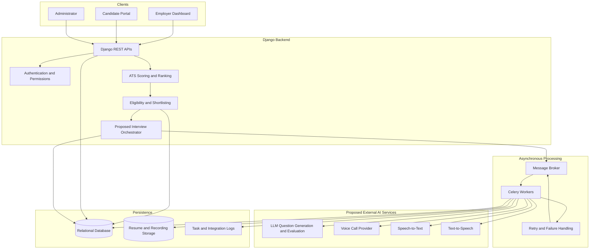
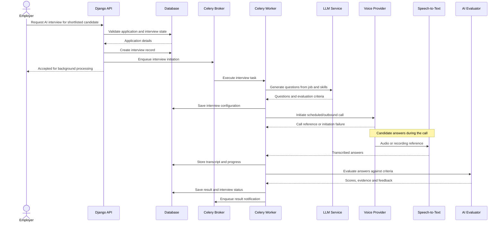
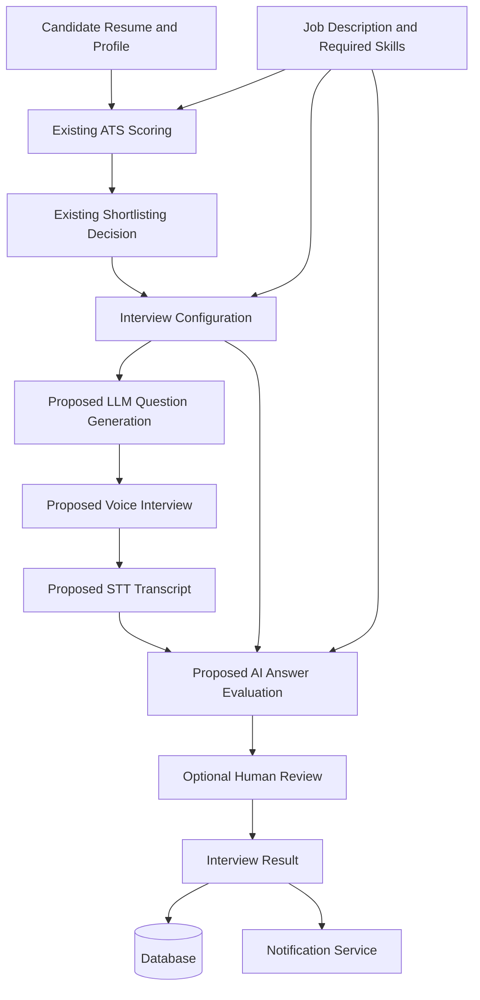

# Day 31: AI System Architecture and Workflow Design

## 1. Objective

Design how AI services, voice-call infrastructure, Django backend APIs, background workers, and persistent storage could work together in the Zecpath recruitment platform.

This document describes the existing backend and a proposed future AI interview integration. Proposed integrations are design recommendations, not claims that the integrations have already been implemented.

## 2. Current Capabilities and Proposed Components

### Existing backend capabilities

- Django REST Framework APIs.
- Candidate, employer, job, and application workflows.
- ATS scoring and candidate ranking.
- Eligibility checks and configurable shortlisting.
- Application status history.
- Notification logging and Celery notification tasks.
- Database-backed recruitment records.

### Proposed AI interview capabilities

- LLM-based interview question generation.
- Voice-call provider integration.
- Speech-to-text (STT).
- Text-to-speech (TTS).
- AI answer evaluation and interview scoring.
- Interview scheduling and result notifications.

These AI interview integrations require implementation and provider selection.

## 3. High-Level Architecture

## 4. Proposed AI Call Sequence

## 5. AI Scoring Data Flow

The proposed interview score is a separate result from the existing ATS score. Any combined score or hiring decision requires an explicitly defined, validated policy; an AI score should not automatically determine hiring outcomes without appropriate oversight.

## 6. Service Interaction and Responsibility

| Component | Responsibility | Status |
|---|---|---|
| Django REST API | Authenticate users and expose recruitment endpoints | Existing |
| ATS service | Match candidate profiles to job requirements | Existing |
| Shortlisting service | Apply configured eligibility and shortlisting rules | Existing |
| Relational database | Store jobs, applications, ATS scores and status history | Existing |
| Celery and broker | Run background work and coordinate tasks | Existing notification-task infrastructure; interview tasks proposed |
| LLM provider | Generate interview questions and evaluate answers | Proposed |
| Voice provider | Place calls and report call events | Proposed |
| STT provider | Convert candidate speech into text | Proposed |
| TTS provider | Convert prompts into speech | Proposed |
| Interview orchestration | Track interview lifecycle and coordinate services | Proposed |
| Recording/object storage | Store recordings if required and consented to | Proposed |

## 7. Design Principles

- Keep external AI and voice-provider calls outside ordinary API request processing.
- Persist interview state before enqueueing work.
- Use explicit timeouts, bounded retries, and idempotency keys.
- Verify incoming provider webhooks before processing them.
- Store provider request IDs and correlation IDs for tracing.
- Protect resumes, transcripts, recordings, and personal data.
- Record the evidence and rubric behind scores.
- Keep hiring decisions reviewable and configurable.
