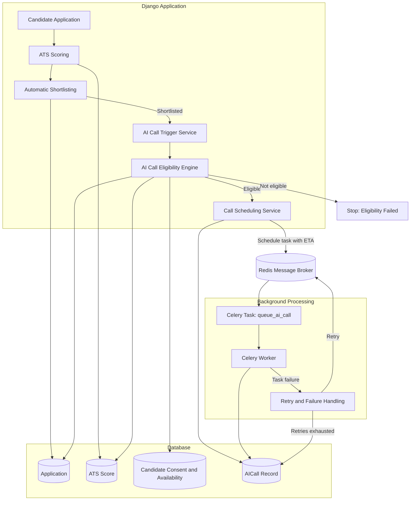

# Day 33 – AI Call Trigger & Eligibility Architecture

## System Architecture

## Component Responsibilities

| Component | Responsibility |
|---|---|
| Django Application | Handles recruitment and shortlisting logic |
| ATS Scoring | Calculates candidate application score |
| Eligibility Engine | Validates consent, availability, job status and ATS threshold |
| Call Trigger Service | Creates an AI call record for eligible applications |
| Scheduling Service | Calculates the next permitted calling time |
| AICall Model | Stores scheduling, status and retry information |
| Redis | Acts as the Celery message broker |
| Celery Worker | Executes the scheduled background task |
| Retry Handler | Handles task failures and retry limits |

## Processing Flow

1. Candidate submits an application.
2. ATS scoring evaluates the application.
3. Automatic shortlisting processes the application.
4. Successful shortlisting triggers AI call eligibility validation.
5. The eligibility engine checks candidate and job requirements.
6. An eligible application receives an AICall database record.
7. The scheduling service calculates the permitted calling time.
8. Celery schedules the background task through Redis.
9. The Celery worker processes the task.
10. The AICall record is updated to reflect queueing or failure.

## Important Implementation Note

The current implementation handles AI call eligibility, scheduling, queueing, retry handling and status tracking.

Actual telephone call initiation, voice interaction and provider callback integration are not implemented in Day 33.
