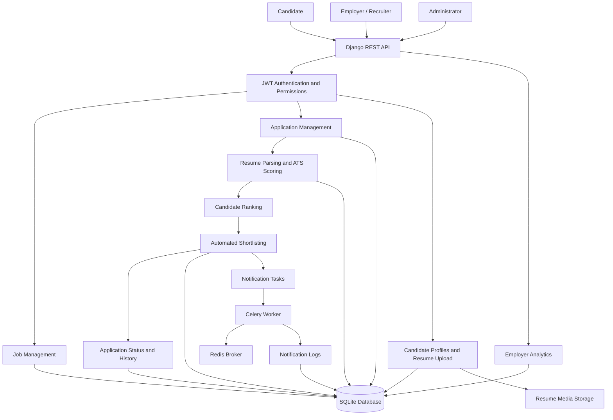

# System Architecture

This diagram illustrates the main components of the Zecpath recruitment backend and their interactions.

## Component responsibilities

- **Django REST API:** Exposes recruitment endpoints.
- **JWT authentication and permissions:** Protects endpoints according to user roles.
- **Job management:** Supports employer job creation and management.
- **Application management:** Handles candidate applications and status history.
- **Resume processing and ATS:** Parses resumes, compares skills, and calculates application scores.
- **Automated shortlisting:** Applies configured rules to application scores.
- **Celery and Redis:** Support asynchronous notification processing when configured and running.
- **Database and media storage:** Store application records and uploaded resumes.

This is a logical architecture diagram, not a deployment diagram. Actual production infrastructure may differ.
